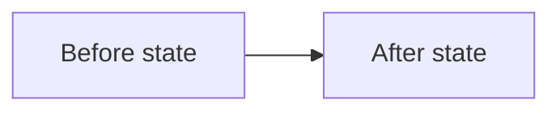

<a id="information-representation-design"></a>
# 🧩 Information representation design

## 🎯 Applicability

| When | Then |
| --- | --- |
| Writing, editing, reviewing, or sending **every user-facing chat reply or message** (including intermediate work-in-progress updates, partial answers, and final replies), and creating or modifying **any other human-readable text**—including documentation, Markdown, PR descriptions and reviews, tickets, emails, websites, articles, agent instructions or skills, and other human-readable outputs. | **Apply all four stages below** while composing or revising that message or artifact, and check the result before sending, saving, or publishing it. Within each stage, apply the rules relevant to the content and medium. |

**Writing process — four stages**

For **each chat message or other human-readable text covered by the condition above**, follow these four stages to create, edit, review, and present that specific output. These are activities in the writing process, **not mandatory headings in the output** or a fixed hierarchy of information.

1. **[🧭 Stage 1 — Structure the reader's route](#stage-1).** Define the questions each part answers and the semantic relationship of its children.
2. **[🗂️ Stage 2 — Choose a representation inside each section](#stage-2).** Select structures and content formats suited to each relationship.
3. **[🎛️ Stage 3 — Apply rules to the chosen format](#stage-3).** Apply the rules for the formats actually used; do not introduce unnecessary tables, code, or visuals.
4. **[🔗 Stage 4 — Anchor sources and recurring references](#stage-4).** Make inspectable sources and repeated references stable and navigable where relevant.

Revisit earlier stages whenever a later choice creates new semantic groups.

<a id="stage-1"></a>
## 🧭 Stage 1 — Structure the reader's route

Use these **four structural decisions recursively**. They are complementary ways to organize information, **not a sequence** and not a hierarchy in which one pattern must contain another.

**Structural decisions in this stage:**

- [S1 — Define the parent contract](#structure-1)
- [S2 — Compose semantic patterns](#structure-2)
- [S3 — Label answers and attach detail](#structure-3)
- [S4 — Adapt to the medium](#structure-4)

<a id="structure-1"></a>
### S1 — Define the parent contract

Identify the questions a reader needs answered and group the corresponding material. For every parent heading, list lead-in, or other grouping, identify the semantic type of its immediate children. The following are **illustrative categories, not an exhaustive taxonomy**:

- **Steps:** actions or stages in a specified order.
- **Principles:** independent guidelines, each with supporting detail.
- **Reasons:** separate explanations of why something matters.
- **Alternatives:** comparable choices.
- **Examples:** concrete illustrations of an introduced rule.
- **Information categories:** different content types grouped by a clear purpose.

Apply these **parent-contract rules at every level**, not only beneath headings:

- **Declare the group type.** Before any set of peer headings, bullets, table entries, or separate statements, tell the reader what kind of items follow—rules, options, steps, reasons, examples, or another accurate category—and whether their order matters. A topic label alone is insufficient: "Continue structuring inside a container" does not say whether the following text is a rule, example, or explanation.
- **Preserve the hierarchy.** Put supporting detail beneath the item it explains, not beside it as if both had the same role. Parent and child must occupy visibly different levels.
- **Make peers structurally consistent.** When siblings play comparable roles, use equivalent labeling, hierarchy, representation, and fields so readers can compare them directly. **Check the information fields, not just visual style:** if one sibling embeds a restriction, reason, qualification, or other information role while its peers only name items, separate that material into a correctly typed group or expose comparable fields in a table. Do not invent values just to make fields symmetrical. This applies to **any** siblings—steps, reasons, alternatives, rules, examples, and other categories. Do not force genuinely different kinds of content into identical formats merely for symmetry; explain a deliberate difference when it matters.
- **Identify real sequences.** Number actions only when order matters. Use identifiers such as P1/P2 for principles when later references benefit; the digits do not automatically imply execution order.
- **Reapply inside containers.** Repeat the same semantic-role test for bullet groups, explanatory paragraphs, table cells, diagram descriptions, and nested sections. A new representation does not exempt its contents from these rules.
- **Avoid redundant labels.** A genuinely continuous explanation can remain prose under an existing label. Do not manufacture extra headings for every sentence; add a new label or peer group when the **reader-facing role changes**.

#### Comparison example — parent contracts

The following are **two versions of the same Markdown structure**. Both are shown as Markdown fences, and their labels appear at the same heading level beneath this example.

##### Negative example — Ambiguous

```markdown
## Release guidance

### Validate a release
Validate the candidate and verify the result.

### Preserve rollback paths
Keep an option to undo deployment.

### Why staged rollout matters
A gradual rollout limits the impact of regressions.
```

All three subsections are presented as peers, although they respectively describe a procedure, a principle, and a reason.

##### Positive example — Clear

```markdown
## Release procedure

Perform these steps in order:

1. Validate the candidate release.
2. Roll out gradually.
3. Verify the result.

## Release principles

Apply these principles throughout the procedure:

### P1 — Make failures visible
Explain the principle and its implications.

### P2 — Preserve rollback paths
Explain the principle and its implications.

## Reasons for staged rollout

- Limit the impact of regressions.
- Detect failures before wider deployment.
```

The parent labels now identify steps, principles, and reasons; their children satisfy those contracts.

<a id="structure-2"></a>
### S2 — Compose semantic patterns

Use the following **alternative semantic patterns** at any level of the information hierarchy. They are neither mandatory templates nor subordinate to S1's categories:

- **Peer items** — independent principles, reasons, changes, or decisions.
- **State → elaborate → exemplify** — claim, explanation, then example or evidence.
- **Before → after → how** — initial state, resulting state, and mechanism of change.
- **What → why → how** — outcome, rationale, and implementation.
- **Completed → remaining** — finished and outstanding work.
- **Claim → meaning → evidence → impact** — assertion, interpretation, proof, and consequence.
- **When → then** — condition and the action or outcome when it holds.
- **Situation → complication → question → answer** — context, disruption, resulting question, and resolution.

**Patterns can contain each other in either direction.** For example, a PR description may have top-level `What`, `Why`, and `How` sections, with individual changes under `What`, reasons under `Why`, and decisions under `How`. Conversely, a section for one change may itself contain `Before`, `After`, and `How` subsections. Use whichever ordering answers the reader's questions.

Reapply a pattern inside a list item, a table cell, or another component when its content warrants further structure and the medium supports it. A table is not the end of semantic organization.

<a id="structure-3"></a>
### S3 — Label answers and attach detail

For each meaningful block, identify the reader question it answers. Give it a **short, skimmable semantic label**, then keep its explanation, evidence, examples, and qualifications directly below.

Apply these **answer-labeling rules**:

- **Length:** Aim for one to three words when that remains accurate; use a longer name where needed.
- **Medium:** Choose a heading, bold lead-in, list label, or another appropriate level.
- **Containment:** Keep details underneath the item they explain rather than promoting them to sibling items.
- **Peer consistency:** Apply S1's structural-consistency rule to all peer items, regardless of their semantic type.
- **Semantic type:** When introducing a standalone instruction, example, reason, or qualification, identify that role before its topic. A bold action phrase alone is not a sufficient label when the reader cannot tell why it appears.

#### Comparison example — identifying a rule group

Both examples are Markdown excerpts about the same organizing-structure decisions.

##### Negative example — Unidentified instructions

```markdown
### Organizing structures

Choose these based on the relationship rather than the content type.

**Continue structuring inside a container:** A table cell can contain
multiple labeled points.
```

The reader encounters two instructions but is not told that they are rules.

##### Positive example — Explicit rule group

```markdown
### Organizing structures

Follow these rules for applying organizing structures:

- **Choose by relationship.** Select the structure that fits the
  relationship between items.
- **Structure nested content.** Reapply semantic grouping inside table
  cells when the renderer supports it.
```

The parent lead-in identifies the following items as rules. Each bullet names a distinct rule and contains its explanation.

**Example — one principle in a testing guide**

- **Assert outcomes.** Check database state after an operation rather than an internal helper call. For example, `assert row["status"] == "ready"` checks an observable outcome; `mock_writer.assert_called_once()` ties the test to an implementation detail.

A longer guide could give the principle a heading; a concise list can use the bold lead-in above.

<a id="structure-4"></a>
### S4 — Adapt to the medium

Use headings for document and article navigation. In a brief message, an opening clause or bold label may be enough. Choose the smallest hierarchy that exposes meaningful relationships.

At each nesting level, ask these **structural review questions** about the *rendered* draft:

- **Group type:** Can a reader tell *what kind of items* follow before encountering the first sibling, even if the items are bullets, table rows, or paragraphs rather than headings?
- **Standalone text:** Does each independent paragraph or bold lead-in clearly function as an explanation, rule, example, condition, or consequence? If not, can it be grouped with a related peer or labeled with its true type?
- **Parent contract:** Do all immediate children have the type their parent promises?
- **Peer presentation and fields:** Do comparable siblings have equivalent labels, visual levels, representations, and information fields? Is a rule, reason, constraint, or qualification hidden in only one item? If so, split distinct roles into separate groups or expose the differing field explicitly.
- **Composition:** Can an item contain an additional pattern without being mistaken for a sibling of that pattern?
- **Order and navigation:** Are sequences distinguishable from unordered alternatives, and can the reader find the desired answer on a quick scan?

**Action after review — repair the draft:** If any block fails, rewrite its lead-in, move it beneath the correct parent, or combine it with other rules/examples of the same type. Recheck the whole document, not only the section recently edited. Do not rely on Markdown syntax validity as evidence of semantic clarity.

<a id="stage-2"></a>
## 🗂️ Stage 2 — Choose a representation inside each section

After identifying semantic relationships, choose how they appear in the target medium.

Stage 2 distinguishes **two representation categories**:

- **Organizing structures:** Headings, lists, and tables group and arrange information, potentially containing further structures.
- **Content representations:** Prose, code excerpts, diagrams, and charts communicate the information within those structures.

### Organizing structures

These forms can contain further semantic patterns and other representations:

| Relationship to express | Organizing structure |
| --- | --- |
| Topic and subtopic navigation | Headings and nested sections |
| Independent peer items | Bulleted list |
| Steps in required order | Numbered list |
| Multiple records with comparable fields | Table |

Follow these **rules for applying organizing structures**:

- **Choose by relationship.** Select headings, lists, or tables based on how the information relates, not the content type. For example, repeated negative/positive examples share comparable fields and may fit a two-column comparison table.
- **Continue structuring within containers.** A table cell can contain multiple labeled points or a nested list when the renderer supports them. Apply the same parent-contract and sibling-consistency rules inside the cell. If the resulting cell becomes difficult to scan or the renderer cannot handle nested formatting, keep it concise and move the details into a clearly labeled section below the table.

### Content representations

These convey the substance within the chosen layout. They are **not competing alternatives** to headings, lists, or tables:

| Information to communicate | Content representation |
| --- | --- |
| Reasoning, explanation, consequences | Prose |
| Exact expression, identifier, command, or implementation | Inline code or code fence |
| Relationships, dependencies, topology, or process flow | Diagram |
| Quantitative comparison or trend | Chart |

**Examples of composable representations:**

- A table cell can contain inline code.
- A section can include a diagram alongside explanatory paragraphs.
- A list item can contain both a short statement and a code example.

**Boundary rule:** A code fence is ordinarily a content element, not a Markdown container for rendering nested tables.

**Example — environment variables**

In a section titled **Configure environment variables**, explain where to configure the settings, then use a table to compare the variables. Here, the table organizes records while the identifiers and values are represented as inline code.

| Variable | Effect | Example value |
| --- | --- | --- |
| `REPOS_DIR` | Root directory for cloned repositories | `~/Repos` |
| `LOG_LEVEL` | Application log verbosity | `debug` |

These are illustrative settings, not values inspected from a project.

<a id="stage-3"></a>
## 🎛️ Stage 3 — Apply rules to the chosen format

The four subsections below are **representation categories**, not ordered steps. Apply only the rules for formats used in the current document.

### 📝 Prose and lists

Apply these **three prose-and-list rules** to the formats used in the current document:

#### T1 — Frame each list

Use a short label or lead-in to say what its children represent and why the reader needs them.

**Available forms and their roles:**

- **Bullets:** unordered items of the same kind.
- **Numbers:** steps whose order matters.
- **Short prose:** connected explanation where causal flow matters more than scanning separate entries.

Give list items meaningful names when useful. For a short message, one sentence can serve as both the label and lead-in.

##### Comparison example — PR-review list

The following examples show two versions of the same PR-review list.

###### Negative example — Unframed

```markdown
## Review

- PR A
- PR B
- PR C
```

###### Positive example — Framed

```markdown
## Pull requests to review

Review these in priority order; read the description before each diff:

1. **PR A** — Fix the data-loss scenario.
2. **PR B** — Remove duplicate processing.
3. **PR C** — Simplify the deployment path.
```

#### T2 — Group scannable items by semantic type

Follow these **grouping rules**:

- **Expose separate peers.** When a sentence or paragraph contains independently scannable items, use bullets, rows, or other suitable containers if doing so improves recognition. Keep inseparable pairs such as "staged versus unstaged changes" together; there is no fixed item-count threshold.
- **Separate different semantic types.** When adjacent items serve different purposes, give each type its own accurately named group, whether the types are changes, steps, reasons, alternatives, evidence, constraints, examples, decisions, or anything else. These are **examples, not a closed list**; derive the categories from the content.
- **Keep connected material together.** Do not create a new group merely because two sentences differ in wording. Split when readers need to recognize a change in semantic role, not simply to increase the number of headings.

##### Comparison example — updater behavior

The following examples show the same updater behavior with different information structures.

###### Negative example — Hard to scan

```markdown
The updater preserves staged versus unstaged changes, untracked and
ignored files, symlinks, executable modes, conflicted indexes, and
previous commits. Submodule copies receive independent Git metadata.
Interrupted-operation metadata is saved as evidence; archived
operations are not automatically resumed in recovery copies.
```

###### Positive example — Easier to scan

```markdown
The updater preserves:

- staged versus unstaged changes
- untracked and ignored files
- symlinks
- executable modes
- conflicted indexes
- previous commits

The following rules apply:

- Submodule copies receive independent Git metadata.
- Interrupted-operation metadata is saved as evidence.
- Archived operations are not automatically resumed in recovery copies.
```

**Illustration scope:** This particular example separates preserved items from operational rules. In another document, the distinct groups might be alternatives and trade-offs, completed work and open questions, or other types determined by the content—not by this example.

#### T3 — Make prose purposeful

Every prose block needs a **reader-facing function**: it either develops the semantic role already identified by its parent or introduces a new, appropriately identified role. That role might be to explain a reason, qualify a decision, describe a step, present evidence, or something else. **Discover the role from the material**; these illustrations are not an exhaustive taxonomy or mandatory heading templates.

Follow these **paragraph-writing rules**:

- **Identify the purpose.** Start with an identifying lead-in or point so the reader knows what the paragraph contributes.
- **Explain the meaning.** Elaborate when a short label cannot communicate the relevant detail.
- **Support the point.** Include evidence, an example, a consequence, or context when it helps the reader understand the item.
- **Separate changed roles.** Start a new paragraph or list item when the purpose changes; identify the new role when it is not already clear from the parent section.

Keep genuinely connected causal reasoning in prose. A new sentence does not automatically require a separate paragraph.

### 📋 Tables

Use a table when the reader compares records with the same columns or conditions with the same fields.

Apply these **table rules**:

- **Purpose:** State what the table contains in a heading or preceding sentence.
- **Rows:** Use each row for one comparable record.
- **Columns:** Put repeated field labels in headers rather than repeating them in every cell.
- **Cell scope:** Move unrelated rules or multi-paragraph explanations out of cells and under the appropriate section.
- **Sequences:** Prefer a numbered list for a simple procedure instead of a one-step-per-row table.
- **Repeated comparisons:** Use a compact comparison table when examples repeatedly have the same fields and cells remain readable.
- **Nested detail:** When a cell needs multiple items, use supported lists, line breaks, or short labels and reapply semantic grouping. If the cell becomes unwieldy or unsupported, provide clearly labeled details below the table.

### 📊 Diagrams and charts

Use a diagram when a relationship, process, topology, or spatial structure is easier to understand visually. Use a chart for quantitative comparisons or trends. **Make the figure and its surrounding explanation two views of the same information**, not disconnected pieces.

Follow these **two diagram-and-chart rules**:

#### R1 — Match referential labels exactly

For visual labels naming an existing code element, document section, category, series, or other source concept, perform these **reference-matching checks**:

- **Locate the target.** Find the actual symbol, heading, data field, or named concept in the current code or document.
- **Copy its exact name.** Match spelling, case, underscores, punctuation, and word order. Do not paraphrase a referential label merely to make the diagram shorter.
- **Use the same name nearby.** Place the exact label in the associated heading, bold lead-in, list item, or table row where its meaning and relationship are explained.
- **Verify both directions.** For each labeled diagram node or chart series, locate its corresponding explanation; for each source concept the figure claims to depict, find the matching visual element. Test literal text searches where the source and rendering permit them.

Generic relationship verbs, axis units, and explanatory annotations do not need a matching source identifier unless they themselves refer to a named source element. Do not invent a code symbol or heading to justify a generic label.

#### R2 — Connect the figure to its explanation

Structure the nearby prose with **the same named concepts** the visual presents. The reader should be able to select a diagram node or chart series, find the identically labeled explanation, learn what it does or measures, and return to the visual to inspect its relationships with other named elements.

Do not insert a figure into text whose headings and item labels use unrelated terminology and rely on a single generic caption to connect them. Explain significant relationships alongside the related elements; place an orienting caption above or below as appropriate for the medium.

**Example — shared labels across text and diagram**

The following illustrative Markdown headings and Mermaid node labels match exactly:

```markdown
### Before state
Requests require manual database updates.

### After state
Requests are processed through a validated workflow.
```



In a code architecture diagram, use actual identifiers (for example, `_keep_intervals_before_rebuild`) rather than approximate names. In a data chart, align series or category names with the names in the adjacent explanatory headings, legend, data source, or supporting table; preserve explicit units for axes.

### 💻 Code and commands

Apply the following four **code rules** when presenting inspected source or executable commands.

When an answer locates, explains, or proposes changing repository code, inspect the relevant source before drafting its description. Compare the final explanation against the actual symbols, expressions, and observed behavior.

#### C1 — Use exact identifiers and concrete operations

Copy the original spelling of any inspected identifier: every character, including punctuation and underscores. Use inline backticks for literal code; use verified links when referring to a located symbol.

The following **four negative/positive comparison examples** share the same two columns. All values and expressions are illustrative, not claims about the current repository. The identifier and source expression shown in the good examples must be verified when applied to actual code.

| Negative example (Bad) | Positive example (Good) |
| --- | --- |
| "the underscore keep intervals before rebuild function" | `_keep_intervals_before_rebuild` |
| "The left-edge partition owns the earlier days." | "Rows where `state_date < rebuild_start` are passed to `_keep_intervals_before_rebuild`." |
| "The older dates are kept." | "Rows where `state_date < rebuild_start` are kept; rows where `state_date >= rebuild_start` are rebuilt." |
| "The old left edge is wrong." | "With `valid_from='2026-10-01'` and `rebuild_start='2026-10-10'`, the output starts at `2026-10-01`; the expected start is `2026-10-10`." |

Apply these **code-explanation rules** when elaborating on the comparisons:

- **Prefer exact operations.** Avoid invented spatial descriptions ("left edge", "tail"), possessive metaphors ("owns", "carries"), or abstract jargon ("partition", "idempotent") **when they replace** the executable operation. Technical concepts remain useful after the actual expression and its observable effect are identified.
- **Ground outputs.** Use representative inputs and resulting values when they make an operation easier to understand. Distinguish observed behavior from a hypothetical demonstration.

#### C2 — Quote inspected source with its scope

When describing existing code, quote its decisive lines. The excerpt establishes **what** is implemented; accompanying prose explains the consequence.

Give every source excerpt two location cues:

- **Immediately above:** a verified clickable file-and-line link.
- **Inside the fence:** the exact source-relative path on the first line as a comment.

Keep enough enclosing syntax to show where the quoted code runs.

Apply these **language-specific quotation rules**, using the language's own comment syntax for omitted spans:

- **Python:** include the actual `def` and, for a method, its enclosing `class`. Mark omissions `# ...`.
- **Markdown:** include the surrounding heading. Mark omissions `<!-- ... -->` when quoting literal Markdown.
- **YAML:** include the parent keys. Mark omissions `# ...`.
- **JSON:** include the enclosing keys. Use a `jsonc` fence for annotated excerpts containing `//` comments.
- **SQL:** include the `SELECT` or CTE name. Mark omissions `-- ...`.
- **Other languages:** include the nearest meaningful declaration and use the language's comment syntax.

Use a language-tagged fence. Verify copied lines against the correct repository revision before linking them.

#### C3 — Show both sides of changes

For proposed or completed code edits, show the same enclosing scope and relevant lines in two separately labeled excerpts:

- **BEFORE:** the original code and its verified source location.
- **AFTER:** the modified code, labeled as *proposed* when not yet applied.

In a larger annotated AFTER excerpt, follow these **change-annotation rules**:

- Mark added lines `# NEW`.
- Mark replaced lines `# CHANGED`.
- Put each commented-out old line directly above its replacement.
- Leave unchanged lines unmarked.

Use the target language's comment syntax. These review annotations explain a change; they are not automatically part of production code.

#### C4 — Distinguish quotations from commands

Apply these **presentation rules by content type**:

- **Markdown wording:** when discussing what quoted text says, use a blockquote or concise paraphrase with a link. Use a `markdown` fence with the enclosing heading when the syntax itself matters.
- **Runnable commands:** show the actual command in a `sh` or `bash` fence with representative arguments. A command being introduced for execution is not a source quotation and needs no invented file path or enclosing function.

<a id="stage-4"></a>
## 🔗 Stage 4 — Anchor sources and recurring references

Apply the following three **reference rules** to mentions of inspectable sources and to recurring labels. These are complementary requirements, not ordered actions.

### L1 — Make source mentions navigable

When the draft names a file, symbol, or other inspectable artifact, locate its real target before adding a link. Verify that the path and line exist in the relevant revision or worktree.

Apply these **source-link rules**:

- **Link label:** Use the symbol or filename as the visible label.
- **Location:** Put the file path and line anchor in the destination rather than an unnecessarily long displayed phrase.
- **Literal identifiers:** Keep link labels plain text and use adjacent inline code for exact symbol spelling when needed.
- **Identifier fidelity:** Preserve the real identifier even when its name is long.
- **Renderer quirks:** If a leading `_` or `*` breaks a link label, omit that character **only in the displayed label**, keeping the complete identifier at the destination or in adjacent inline code.
- **Unresolved targets:** Show the exact known locator in backticks and state what could not be verified.

#### Comparison example — source-link labels

The two cases below compare labels for the same illustrative link destination:

| Negative example — vague label | Positive example — precise label |
| --- | --- |
| `[here](src/loader.py#L90)` or `[line 90](src/loader.py#L90)` | `[loader.py:90](src/loader.py#L90)`

### L2 — Resolve links for the destination

| Where readers open the text | Link target |
| --- | --- |
| Chat using a local repository workspace | Relative to the session working directory, with a verified line anchor |
| Markdown inside the same repository | Relative to the containing Markdown file's directory; verify the target path |
| Markdown referring to another repository | Git-host URL to that repository; prefer a stable repository-level destination when file and line links may drift |
| PR, external ticket, documentation app, or messaging app | Absolute URL usable without a local checkout |

A remote Git-host link must refer to a revision that exists there. For an uncommitted change, use a local source locator rather than pretending it is already available remotely.

### L3 — Keep repeated references stable

When a fact, rule, question, or example is cited again later in the same explanation, give it a short bold identifier at first mention, such as **F1**, **R1**, or **Q1**. Use the same bold identifier at every subsequent reference.

Use labels only where later references benefit from them; one-off statements need no numbered tag.
